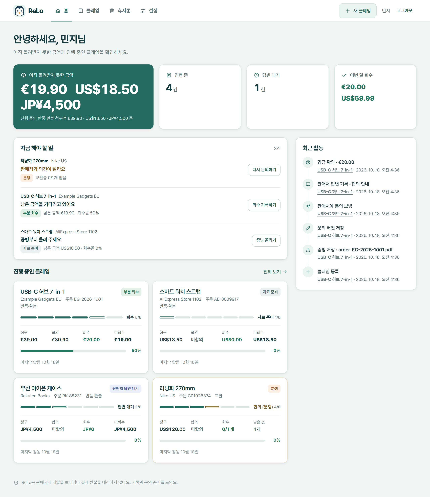
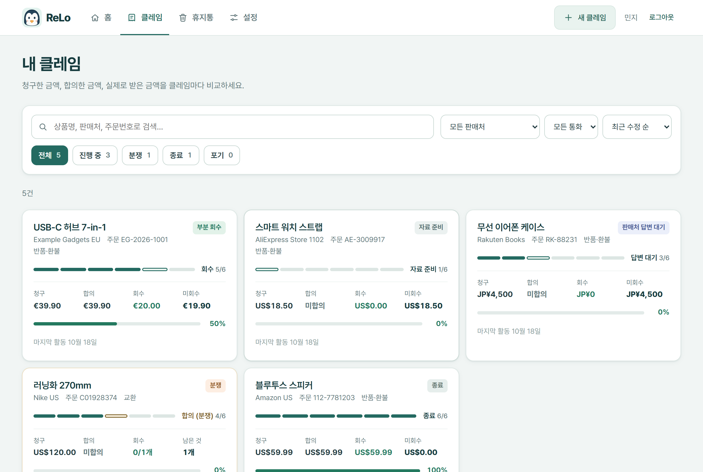
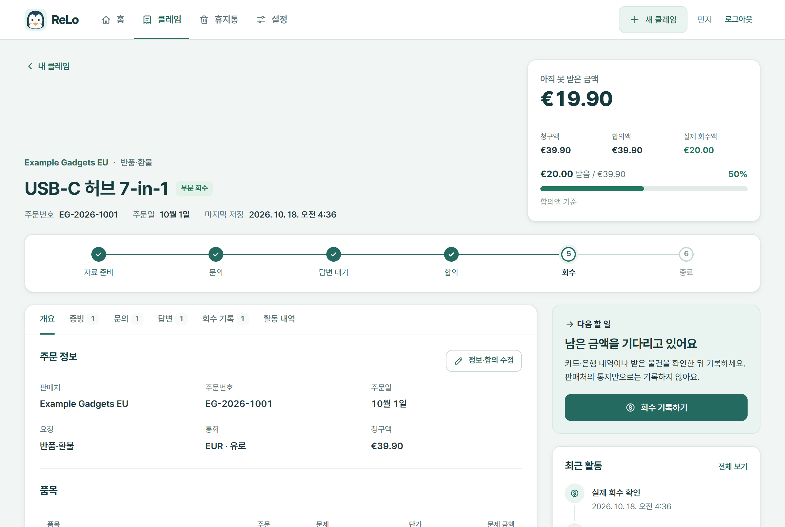
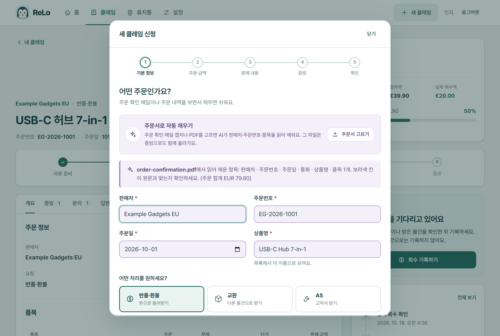
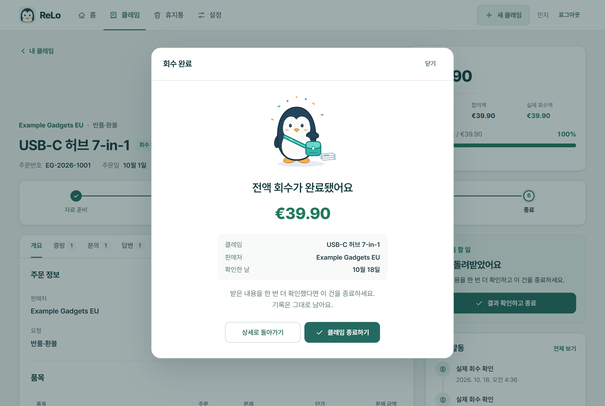
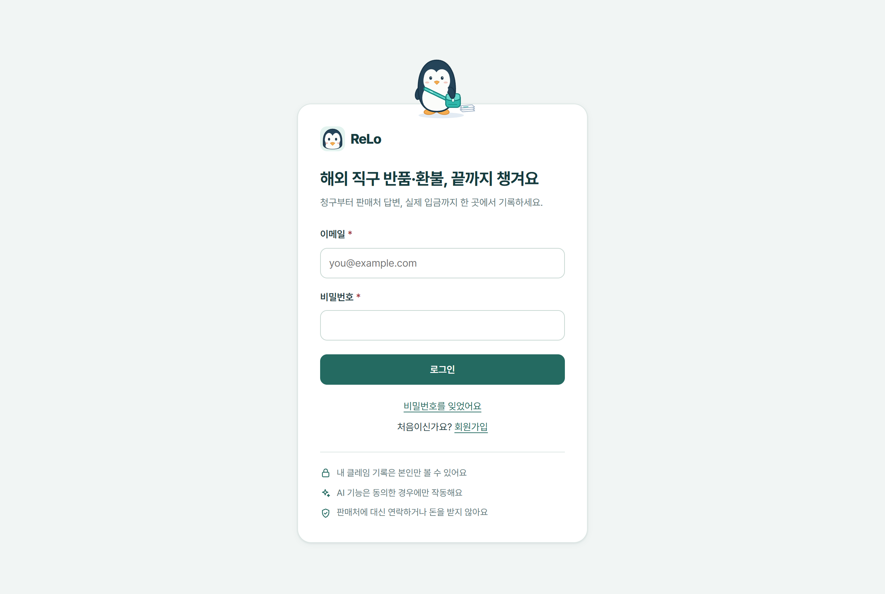
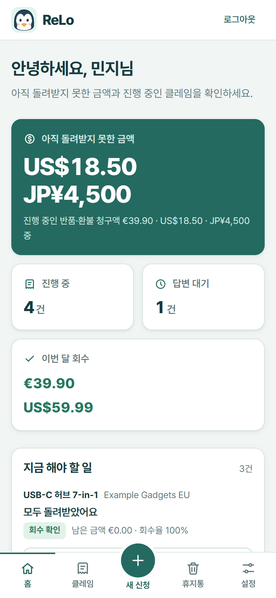
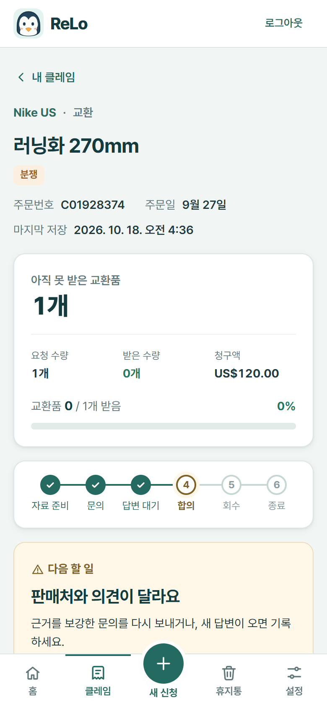

# ReLo · 해외 직구 클레임 기록

해외 쇼핑몰에서 산 상품의 반품·교환·AS를 **청구 → 판매처 문의 → 답변 → 실제 회수**까지 한 곳에서 기록하는 개인용(B2C) 웹 서비스다.

> 처음 보는 사람은 [처음 온 사람을 위한 안내](#처음-온-사람을-위한-안내)부터 읽는다.

## 화면

홈은 **현황판**(얼마가 남았고 무엇부터 할지), 클레임 상세는 **실행판**(금액·단계·다음 할 일), 새 클레임은 **5단계 신청**이다.

| 홈 (현황판) | 클레임 목록 |
|---|---|
|  |  |
| **클레임 상세 (금액 카드·진행 단계·다음 할 일)** | **새 클레임 1단계 (주문서로 자동 채우기)** |
|  |  |
| **회수 완료** | **로그인** |
|  |  |

 

휴대폰(390px): 하단 탭 바 가운데에 "새 신청" 버튼이 떠 있다. 분쟁 건은 노란 단계와 노란 "다음 할 일"로 표시된다.

## 주요 기능

### 계정
- 회원가입·로그인. 각자 자기 클레임만 본다.
- 가입하면 이메일 인증 링크(24시간)를 보낸다. 인증 전에는 화면 맨 위에 안내 띠가 보인다.
- 비밀번호를 잊으면 재설정 링크(30분, 한 번만)를 받는다. 비밀번호를 바꾸면 모든 기기에서 로그아웃된다.
- 설정에서 내 데이터 내보내기(JSON), 회원 탈퇴(전체 삭제), AI 처리 동의·철회를 할 수 있다.

### 홈과 목록
- **홈**: 아직 돌려받지 못한 금액(반품·환불 건, 통화별), 진행 중·답변 대기 건수, 이번 달 회수 금액을 맨 위에 보여 준다. 그 아래 "지금 해야 할 일"(바로 할 수 있는 일부터 3건, 버튼 한 번으로 그 일을 시작), 진행 중인 클레임 카드, 최근 활동.
- **클레임 목록**(`#/claims`): 검색, 상태 칩(진행 중·분쟁·종료·포기), 판매처·통화로 거르기, 정렬(최근 수정·미회수 금액·진행 단계). 미회수 금액 순은 통화별로 묶어서 정렬한다.

### 클레임
- **새 클레임 5단계**: 기본 정보 → 주문·금액 → 문제 내용 → 증빙 → 확인. 단계마다 그 단계 칸만 검사하고, 품목의 "문제 수량 × 단가" 합계를 청구액으로 제안한다. 4단계에서 고른 증빙은 등록할 때 함께 올라간다. AI가 켜져 있으면 1단계에서 **주문서로 자동 채우기**를 쓸 수 있다.
- **다음 할 일**: 상세 화면이 지금 할 일 하나와 그 버튼을 보여 준다(증빙 올리기 → 문의 초안 → 보냈어요 → 답변 기록 → 합의액 입력 → 회수 기록 → 종료). 분쟁·추가 증빙 요청·다시 써야 할 초안은 노란색으로 알린다. 상태를 직접 바꾸는 일과 휴지통 이동은 "사건 관리"에 접어 두었다.
- **판매처·통화**: 판매처는 자유롭게 입력한다. 통화는 USD·EUR·GBP·JPY·CNY·KRW·CAD·AUD를 쓸 수 있고, 합계는 통화별로 따로 낸다.
- **세 가지 금액을 따로 기록**: 청구액, 합의액, 실제로 받은 금액. 판매처의 "환불했다" 통지만으로는 입금으로 치지 않는다.
- **진행 단계**: 자료 준비 → 문의 → 답변 대기 → 합의 → 회수 → 종료. 분쟁·포기도 표시한다.
- **회수율 막대**: "받은 것 / 합의액(없으면 청구액)"을 보여 준다. 교환은 수량, AS는 수리 확인 여부로 계산한다.
- **증빙**: 주문서·사진 등 PDF·PNG·JPG·WebP 파일(10MB까지)을 끌어 놓거나 골라서 올린다(여러 개 한 번에). 사진은 썸네일로 보인다. 본인만 열 수 있다.
- **문의**: 영문 문의 초안(AI·기본 틀·직접 작성)을 만들고 고쳐서 버전으로 저장한다. 편집 창은 받는 곳, AI 요약, 보내기 전에 채울 항목, 제목·본문, 옆에 사건 요약·증빙·최근 답변을 보여 준다. 판매처에 직접 보낸 뒤 "보냈어요"를 기록한다. 사건 정보가 바뀌면 예전 초안은 다시 써야 한다고 표시한다.
- **판매처 답변**: 받은 원문을 붙여 넣고 종류(추가 증빙 요청, 합의 안내, 환불 처리 통지, 거절, 기타)를 카드로 고른다. 고르면 저장했을 때 무엇이 바뀌는지 한 줄로 알려 준다.
- **실제 회수 기록**: 입금·교환품·수리 결과를 증빙과 함께 기록한다.
  - 금액을 치는 동안 "실제 회수액 €0.00 → €20.00, 회수율 0% → 50%"처럼 저장 후 모습을 미리 보여 준다.
  - 같은 거래가 두 번 세지지 않게 막는다.
  - 기록은 고치지 않고 "정정" 항목을 추가한다.
  - 전부 돌려받은 순간 한 번 축하 화면이 뜨고, 거기서 바로 종료할 수 있다.
- **활동 내역**: 이 건에서 한 일을 시간순으로, 바뀐 칸은 "합의액: 없음 → €39.90"처럼 글로 보여 준다.
- **휴지통**: 지운 클레임도 증빙·기록은 남고, 복원할 수 있다. 영구 삭제는 회원 탈퇴 때뿐이다.

### AI (Google Gemini, 사용자가 동의한 경우만)
- 기능: 영문 문의 초안, 문제 설명 번역, 판매처 답변 번역·분석(추천 다음 행동 포함), 주문서 PDF·이미지에서 주문 정보 읽기(올린 증빙에서, 또는 새 클레임 1단계에서 클레임을 만들기 전에).
- **AI 결과는 미리보기다.** 사용자가 확인하고 저장해야 반영된다. AI가 채운 입력칸은 사용자가 고칠 때까지 보라색이다.
- 기다리는 동안(실측 7~19초) 무엇을 하는 중인지, 몇 초 지났는지, 취소 버튼을 보여 준다.

### 화면 편의
- 틀린 입력칸 바로 아래에 한국어 오류를 띄우고 그 칸으로 커서를 옮긴다.
- 입력하던 창을 닫으려 하면 한 번 묻는다.
- 휴대폰에서는 하단 탭 바(홈·클레임·새 신청·휴지통·설정)를 쓰고, 창은 아래에서 올라오는 시트로 연다. 새 클레임과 문의 편집은 화면 전체를 쓴다. 상세 탭은 칩 모양 버튼이다.
- 펭귄 캐릭터 **도리**가 로그인 인사, 빈 화면, 문의 준비, 회수 완료 축하에 나온다.
- 글꼴은 Pretendard를 함께 배포한다.

### 하지 않는 것
- **판매처에 메일을 보내지 않는다.** 앱이 보내는 메일은 계정 메일(인증·비밀번호 재설정)뿐이다.
- **돈을 주고받지 않는다.** 환불은 판매처가 사용자에게 직접 하고, 앱은 기록만 한다. → [정한 것](#정한-것)

## 실행

Node 24.15 이상이 필요하다. 서버 실행에는 추가 패키지가 없다. `npm install`은 브라우저 시험용 `playwright-core`만 설치한다.

```bash
npm install
npm start
```

http://127.0.0.1:4180 을 연다. 개발 모드에서는 데모 계정(`demo@relo.test` / `Demo-Only-2026!`)이 자동으로 만들어진다.

**키 없이 AI 화면 보기**: `.env`에 `AI_PROVIDER=fake`를 넣으면 실제 Gemini 대신 정해진 예시 답을 돌려주는 가짜 AI로 모든 AI 화면을 시험할 수 있다. 개발·시험 전용이다.

### 환경 변수 (`.env`)

`.env.example`을 `.env`로 복사해서 쓴다. **`.env`는 절대 커밋하지 않는다**(`.gitignore`에 들어 있다).

| 변수 | 내용 | 없으면 |
|---|---|---|
| `APP_ENV` | `development` / `test` / `production` | `development` |
| `PORT` | 서버 포트 | 4180 |
| `APP_ORIGIN` | 운영 주소. `https://`여야 한다 | 운영에서는 필수 |
| `DATA_DIR` | DB·업로드 파일 폴더 | `.relo-data` |
| `SEED_DEMO` | `1`이면 데모 계정 생성 | 개발에서만 켜짐 |
| `GEMINI_API_KEY` | Gemini 키 | AI 버튼이 숨겨진다 |
| `GEMINI_MODEL` | 모델 | `gemini-3.5-flash-lite` |
| `AI_PROVIDER` | `gemini` / `fake`(개발·시험용 가짜 AI) / `disabled` | 키가 있으면 `gemini`, 없으면 `disabled` |
| `AI_HOURLY_LIMIT` | 사용자 1명의 시간당 AI 호출 수 | 30 |
| `RESEND_API_KEY` | 계정 메일 발송 키 | 개발에서는 메일 대신 서버 로그에 링크를 출력한다 |
| `MAIL_FROM` | 발신 주소 (인증된 도메인) | 운영에서는 필수 |
| `MAIL_PROVIDER` | `resend` / `console`(로그 출력) / `disabled` | 키가 있으면 `resend`, 없으면 개발 `console`·운영 `disabled` |

이 밖의 세부 설정(세션·링크 유효 시간, 요청 시간 제한)은 `src/server/config.mjs`에 있다.

### AI 켜기

`.env`에 `GEMINI_API_KEY`를 넣는다. 키가 없으면 AI 버튼이 숨겨지고 기본 영문 틀로 동작한다. 자세한 내용은 [docs/AI.md](docs/AI.md)를 본다.

```bash
npm run ai:smoke
```

위 명령은 실제 키로 네 가지 AI 기능을 한 번씩 확인한다.

### 계정 메일 (인증·비밀번호 재설정)

메일은 [Resend](https://resend.com)로 보낸다. `.env`에 `RESEND_API_KEY`를 넣으면 Resend가 켜진다.

- **발신 주소**: `MAIL_FROM`(예: `ReLo <no-reply@내도메인>`)이다. 그 도메인은 Resend에서 인증(SPF·DKIM)해야 한다.
- **`MAIL_FROM`이 없을 때**:
  - 개발에서는 Resend 시험 발신자(`onboarding@resend.dev`)를 쓴다. 이 발신자는 **내 Resend 계정 주소로만** 배달된다.
  - 운영에서는 서버가 시작하지 않는다.

```bash
npm run mail:smoke -- you@example.com
```

위 명령은 실제 키로 시험 메일 한 통을 보낸다.

키가 없으면 이렇게 동작한다.
- **개발·시험**: 메일을 보내지 않고 **서버 로그에 출력**한다(`MAIL_PROVIDER=console`). `npm start`를 띄운 터미널에서 `[mail]`로 시작하는 줄의 링크를 브라우저에 붙여 넣으면 된다. 데모 계정은 인증된 상태로 만들어진다.
- **운영**: console을 쓸 수 없고, 메일 기능이 꺼진다(`MAIL_PROVIDER=disabled`). 인증 띠와 '비밀번호를 잊었어요' 링크가 숨겨진다.

## 명령

| 명령 | 내용 |
|---|---|
| `npm start` | 서버 실행 (`.env` 자동 적용) |
| `npm run dev` | `src/` 변경 시 자동 재시작 |
| `npm test` | 단위 + HTTP 통합 시험 (네트워크 없이 가짜 AI 사용) |
| `npm run test:browser` | 설치된 Chrome으로 가입부터 회수 기록까지 실제 화면 시험 |
| `npm run verify` | 문법 검사 → 시험 → 브라우저 시험을 순서대로. **PR 전에 반드시 통과시킨다** |
| `npm run check` | 모든 `.mjs` 문법 검사 |
| `npm run ai:smoke` | 실제 Gemini 연결 확인 (API 호출 4회) |
| `npm run mail:smoke -- 주소` | 실제 Resend로 시험 메일 1통 발송 |
| `npm run backup` | 운영 DB 백업. `-- --verify`를 붙이면 변경 이력 무결성도 검사 |

## 구조

서버는 **라우트 → 서비스 → 리포지토리** 계층이고, 화면은 **View → ViewModel → Model**(MVVM)이다. 빌드 도구와 프레임워크 없이 Node 24 내장 기능(HTTP, SQLite)과 브라우저 ES 모듈만 쓴다.

```
src/server/   Node HTTP 서버 (domain, repositories, services, routes, ai, mail, http)
src/web/      화면 (core, models, viewmodels, views, styles, assets)
tests/        unit, http, browser
docs/         설계 문서와 화면 캡처
```

| 문서 | 내용 |
|---|---|
| [docs/ARCHITECTURE.md](docs/ARCHITECTURE.md) | 폴더 지도, 계층 규칙, 요청 하나가 지나가는 길, 오류 규칙, **새 기능 추가 체크리스트** |
| [docs/DESIGN.md](docs/DESIGN.md) | 디자인 명세: 간격·모서리·글자·색 토큰, 정렬 규칙, 컴포넌트, **언제 어떤 애니메이션을 몇 ms로**, 상태 문구, 접근성 |
| [docs/AI.md](docs/AI.md) | Gemini 설정, 기능별로 보내는 데이터, 프롬프트 위치, 안전장치, 비용 확인 |
| `docs/archive/` | 이전 B2B 시제품 검증 기록 (참고용) |

## 처음 온 사람을 위한 안내

1. **한 바퀴 써 본다**: `npm install` → `npm start` → 데모 계정으로 로그인한 뒤 이 순서로 눌러 본다. 2번부터는 상세 화면의 **"다음 할 일" 카드 버튼**만 따라가도 된다.
   1. 새 클레임(5단계, 4단계에서 증빙을 함께 골라도 된다)
   2. 증빙 올리기
   3. 문의 초안 → 저장 → 보냈어요
   4. 판매처 답변 기록(합의 안내)
   5. 합의액 입력
   6. 실제로 받은 것 기록(전액이면 축하 화면)
   7. 클레임 종료하기

   AI를 보고 싶으면 `.env`에 `AI_PROVIDER=fake`를 넣는다(새 클레임 1단계의 "주문서로 자동 채우기"도 이걸로 볼 수 있다).
2. **읽는 순서**: 이 README → [ARCHITECTURE.md](docs/ARCHITECTURE.md) → [DESIGN.md](docs/DESIGN.md) → [AI.md](docs/AI.md).
3. **고칠 곳 찾기**:

   | 고치고 싶은 것 | 위치 |
   |---|---|
   | 화면 모양·문구 | `src/web/views/` + `src/web/styles/` (공용 조각 `components.css`, 화면 배치 `pages.css`) |
   | 화면 상태·버튼 동작 | `src/web/viewmodels/` |
   | "다음 할 일" 순서와 문구 | `src/web/viewmodels/claim-progress.mjs`의 `selectNextAction` |
   | API | `src/server/routes/` → `services/` |
   | 업무 규칙(금액·상태·검증) | `src/server/domain/` |
   | DB | `src/server/repositories/` (구조 변경은 `migrations/`에 새 파일) |

## 작업 규칙

- **main에 직접 커밋하지 않는다.** 브랜치를 만들고 → `npm run verify` 통과 → PR → main에 머지한다.
- **계층 규칙을 지킨다**(`tests/unit/architecture.test.mjs`가 검사한다).
  - View는 서버를 직접 부르지 않는다.
  - ViewModel은 DOM을 만지지 않는다.
  - SQL은 리포지토리에만 쓴다.
- **화면 문구는 한국어**로 쓴다. 로딩 중 표시는 "…"로 끝내고, 오류 문장에는 어떻게 고치면 되는지를 쓴다.
- **디자인 값은 토큰으로 쓴다.** 모서리·간격·색·애니메이션 시간에 숫자를 직접 쓰지 말고 `base.css` 토큰과 [DESIGN.md](docs/DESIGN.md)를 따른다.
- **새 입력 검증**은 `forField('입력칸 이름', …)`로 감싼다. 그래야 화면이 그 칸 아래에 오류를 띄운다.
- **AI 결과는 자동 저장하지 않는다.** 미리보기 → 사용자 확인 → 저장 순서를 지킨다.
- **키·`.env`·DB 파일(`.relo-data*/`)은 커밋하지 않는다.**

## 지금까지 한 일

| 날짜 | PR | 내용 |
|---|---|---|
| 2026-10-13 | [#1](https://github.com/jeonghun267/AI_Agent/pull/1) | B2B 합성 데이터 시제품 (업체·역할·관리자 승인) |
| 2026-10-17 | [#2](https://github.com/jeonghun267/AI_Agent/pull/2) | **B2C 전환**: 회원가입, 판매처 자유 입력·다통화, 휴지통·내보내기·탈퇴. 서버 계층형, 화면 MVVM으로 재구성. Gemini 연결(초안·번역·답변 분석·문서 읽기). 디자인 명세 작성·적용 |
| 2026-10-17 | [#3](https://github.com/jeonghun267/AI_Agent/pull/3) | AI 대기 안내와 취소, 입력칸 아래 오류 표시, 작성 중 닫기 경고, 토스트가 창 뒤에 가려지던 문제 수정 |
| 2026-10-17 | [#4](https://github.com/jeonghun267/AI_Agent/pull/4) | 이메일 인증·비밀번호 재설정, Resend 발송 |
| 2026-10-17 | [#5](https://github.com/jeonghun267/AI_Agent/pull/5) | UI 꾸미기: 진행 단계·회수율 막대, 도리 인사·축하, Pretendard 글꼴 |
| 2026-10-18 | `feat/redesign` | **전체 UI/UX 리디자인**: 홈 현황판(못 받은 금액·지금 해야 할 일·최근 활동), 클레임 목록 화면(칩 필터·정렬), 상세 실행판(금액 카드·다음 할 일·사건 관리), 새 클레임 5단계 신청과 주문서로 자동 채우기(`POST /api/ai/extract`), 문의 준비 창·답변 카드·회수 미리보기, 모바일 "새 신청" 탭. 교환·AS 건은 못 받은 금액에서 뺐다 |

검증 상태(2026-10-18):
- `npm run verify` 통과: 단위·HTTP 63개, 브라우저 3개
- 실제 Gemini 4기능 확인 완료
- 실제 메일 발송은 미확인 (아래 "다음 할 일")

## 정한 것

| 정한 것 | 이유 |
|---|---|
| 개인용(B2C). 업체·역할·관리자 승인은 없앴다 | 사용자 한 명이 자기 건을 처음부터 끝까지 관리한다 |
| **계좌번호를 저장하지 않는다** | 민감한 금융 정보라 보관 부담과 위험이 크다. 필요하면 사용자가 판매처 양식에 직접 입력한다 |
| **환불금을 대신 받아 전달하지 않는다** | 남의 돈을 받아 전달하면 전자금융 관련 등록·허가 문제가 생길 수 있다(정확한 판단은 전문가 확인 필요). 판매처가 사용자에게 직접 환불한다 |
| 은행·카드 내역 자동 조회를 하지 않는다 | 오픈뱅킹·마이데이터 허가와 보안 부담이 크다. 사용자가 확인하고 기록한다 |
| 판매처에 메일을 보내지 않는다 | 잘못 보내면 되돌릴 수 없다. 사용자가 복사해서 공식 문의 창구에 보낸다 |
| AI는 동의한 사용자만 쓰고, 결과는 미리보기다 | 입력이 Google(국외)로 전송된다. 틀린 값이 그대로 저장되면 안 된다 |
| Gemini 기본 모델 `gemini-3.5-flash-lite` | Google이 새 프로젝트용 저비용 모델로 권장한다(2026-10 기준) |
| 빌드 도구·프레임워크 없음 | 의존성이 적어야 인수인계와 유지보수가 쉽다 |
| 차트·검증·이미지 편집 라이브러리(Chart.js, validator.js, Cropper.js)를 넣지 않았다 | 회수 현황은 기본 `<progress>`와 CSS로 충분하고, 입력 검증은 서버 `domain/validation.mjs`가 맡는다. 증빙은 원본 그대로 두는 편이 낫다. 외부 CDN은 CSP(`default-src 'self'`)와 브라우저 시험이 막으므로 쓰려면 파일을 직접 넣어야 한다 |
| 새 클레임은 페이지가 아니라 다이얼로그 안의 단계형 폼이다 | 다이얼로그는 열린 동안 다시 그리지 않아 입력이 지켜지고, 작성 중 닫기 경고·입력칸 아래 오류를 그대로 쓴다. 모바일에서는 화면 전체를 쓴다 |

## 다음 할 일

1. **환불 받을 곳 기록 + 스토어 크레딧 구분** (제안됨)
   - 클레임에 "환불 받을 곳"(카드 취소, PayPal, 계좌이체, 스토어 크레딧)을 선택한다. 계좌번호는 저장하지 않는다.
   - 판매처 포인트로 받은 것을 현금 입금과 따로 센다.
2. **실제 메일 발송 확인**: 도메인이 정해지면 Resend 가입 → 도메인 인증 → `.env`에 `RESEND_API_KEY`·`MAIL_FROM` → `npm run mail:smoke`.
3. **화면**: 다크 모드, 로그인 전 서비스 소개(랜딩) 페이지.
   - 증빙 PDF 첫 장 미리보기: 지금은 PDF가 아이콘으로 보인다. CSP가 `blob:` 프레임을 막아서, 하려면 PDF.js를 저장소에 직접 넣어야 한다.
   - 증빙 역할 태그(주문서·불량 사진·대화 캡처): 파일 표에 칸이 없어서 아직 고르지 않는다. 하려면 `migrations/`에 새 칸을 추가한다.
   - 작성 중이던 새 클레임 초안을 새로고침 뒤에도 이어 쓰기(지금은 창을 닫을 때 경고만 한다).
4. **상용화 전에 필요한 것**:
   - **Resend 운영 설정**: 발신 도메인 인증(SPF·DKIM), 운영용 키(발송 전용 권한). 반송·스팸 신고 처리(Resend 웹훅)는 아직 없다.
   - **가입 단계의 이메일 열거**: 가입하면 바로 로그인되므로, 이미 가입한 이메일에는 409로 답할 수밖에 없다(IP당 시간당 10회로 제한). 완전히 막으려면 "메일 링크를 연 뒤에 계정 생성"으로 흐름을 바꿔야 한다. 비밀번호 재설정 요청은 이미 계정 유무를 드러내지 않는다.
   - **배포**: HTTPS 호스트, 영속 디스크, 외부 백업 보관. `APP_ENV=production`과 `APP_ORIGIN=https://…`를 설정해야 한다.
   - **법률 검토**: 이용약관·개인정보처리방침, 국외 이전(Google Gemini, Resend) 고지 문구.
   - **Gemini 유료 등급 전환**: 무료 등급은 입력이 모델 개선에 쓰일 수 있다.
   - 업로드 파일 악성코드 검사.
   - 사용료를 받는다면 결제 연동(PG). 이때 사업자등록·통신판매업 신고 확인이 필요하다.
   - **여러 서버 인스턴스 운영**: 로그인·재설정 요청 시도 제한이 메모리 기반이라 단일 프로세스 기준이다.
